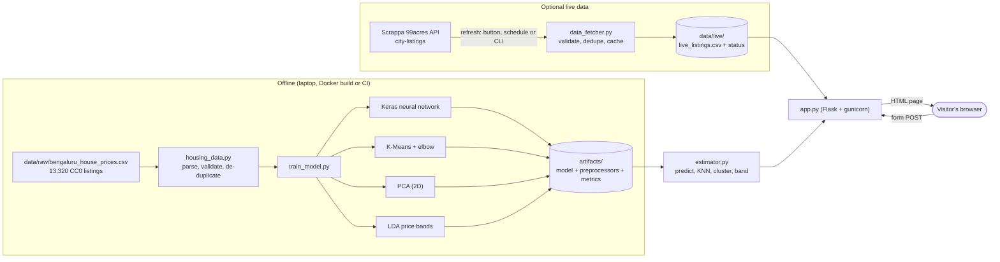
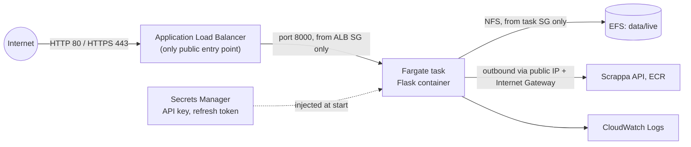

# Affordable Housing Price Estimator (Bengaluru and Mumbai, India)

A small, complete machine-learning website for a Foundations of Machine Learning (FOML) mini-project.
A visitor picks a city (**Bengaluru** or **Mumbai**), enters a home's locality, size and rooms and gets:

1. an **estimated price** in rupees and lakh from a TensorFlow/Keras **neural network**,
2. the **3 most similar recorded properties** found with **K-nearest neighbours (KNN)**,
3. a **K-Means property group** with a plain-English summary,
4. a **price band** (lower / middle / upper third) from **Linear Discriminant Analysis (LDA)**,
5. a **PCA** map showing where the home sits among all properties,
6. model performance, data source, refresh time and a clear valuation disclaimer.

It is one Flask application (HTML templates, Bootstrap and a little JavaScript), runs on a laptop
without any cloud account, and deploys to AWS ECS Fargate with the files in this repository.

> **Disclaimer.** The estimate is an indicative machine-learning estimate for learning purposes.
> It is not an official valuation, not a guaranteed market price and must not be used for buying,
> selling, lending or tax decisions.

---

## Contents

1. [The problem and the user workflow](#1-the-problem-and-the-user-workflow)
2. [Which FOML lab concepts are used, and where](#2-which-foml-lab-concepts-are-used-and-where)
3. [Data sources investigated and chosen](#3-data-sources-investigated-and-chosen)
4. [Architecture](#4-architecture)
5. [Folder structure](#5-folder-structure)
6. [Run it locally (step by step)](#6-run-it-locally-step-by-step)
7. [Live data: API, caching and refresh](#7-live-data-api-caching-and-refresh)
   - [Mumbai: current Housing.com listings via Apify](#7b-mumbai-current-housingcom-listings-via-apify)
8. [Model training and evaluation](#8-model-training-and-evaluation)
9. [Tests](#9-tests)
10. [Docker](#10-docker)
11. [Deploy to AWS ECS Fargate](#11-deploy-to-aws-ecs-fargate)
12. [GitHub Actions (optional)](#12-github-actions-optional)
13. [Delete the AWS resources](#13-delete-the-aws-resources)
14. [Limitations](#14-limitations)
15. [Troubleshooting](#15-troubleshooting)
16. [Licences and attribution](#16-licences-and-attribution)

---

## 1. The problem and the user workflow

Home buyers in Indian cities often have little idea whether an asking price is reasonable for the size and
location. This project shows how classic FOML techniques can give a **rough, explainable** reference point
from real historical listings, and shows the evidence behind it (similar recorded properties and the group
the home belongs to) rather than a single unexplained number.

**Workflow:** open the website → type a locality (with suggestions), size in square feet, bedrooms (BHK),
bathrooms, balconies, how the size is measured and whether it is ready to move in → press
*Estimate price* → read the estimate, the comparables, the group, the price band and the PCA map.

Only fields that exist in the training dataset are asked for. **Property age and furnishing are not offered
because the dataset does not record them**, and the city is fixed to Bengaluru because the training data
covers only Bengaluru.

## 2. Which FOML lab concepts are used, and where

I inspected the uploaded `FOML.zip` notebooks and the handwritten notebook PDF (56 pages: linear algebra,
neural networks and gradient descent, activation functions, PCA by covariance/eigenvectors, LDA scatter
matrices, hierarchical clustering). The implementation reuses these specific patterns:

| FOML material | What it taught | How it is used here | File |
|---|---|---|---|
| **Lab 17 TensorFlow** (`J047_Assignment14_Lab_17_Tensorflow.ipynb`) | `Sequential` + `Dense` layers, `model.compile(loss=..., optimizer="adam")`, `model.fit(epochs, batch_size)`, `EarlyStopping(restore_best_weights=True)`, `StandardScaler`, `train_test_split`; the note "regression → mean_square_error" | Price network `Input → Dense(64, relu) → Dense(32, relu) → Dense(1, linear)`, MSE loss, MAE metric, Adam, batch 32, early stopping on validation loss, 80/20 split | `train_model.py: build_network, train` |
| **Labs 12-14** (activation functions, `FWDP`, `BWP`, `compute_cost`, `ANN`) and notes pages on forward/back propagation | ReLU/sigmoid/linear activations, forward propagation, cost, gradient descent | ReLU hidden layers; **linear** output instead of the lab's sigmoid because the target is a number, not a probability; Keras does forward/back propagation internally | `train_model.py` |
| **Lab 23** (NN on PCA components) | Comparing a model with a reference | Network compared with two simple non-ML baselines on the same test set | `train_model.py` |
| **Lab 28 KNN** (`KNeighborsClassifier(n_neighbors=5)`) | Distance-based nearest neighbours | `NearestNeighbors(n_neighbors=3)` on scaled log-area, bedrooms, bathrooms (price excluded) to retrieve comparables. Same algorithm, used to *retrieve* neighbours instead of voting on a class | `estimator.py: similar_properties` |
| **Lab 28 K-Means** (`KMeans(n_clusters, random_state)`, labels, centroids) | Clustering | K-Means (k = 4) on scaled log-area and log-price; groups renumbered 1-4 by median price | `train_model.py`, `estimator.py: cluster_for` |
| **Lab 29** (elbow method, WCSS = `inertia_`) | Choosing k | WCSS for k = 1..8 saved in `artifacts/<city>/metrics.json` | `train_model.py` |
| **Labs 18-23 PCA** (centre data, covariance, eigenvectors, `PCA(...)`, `explained_variance_ratio_`, `transform`) | Dimensionality reduction | Five scaled features reduced to 2 components for a scatter plot; explained variance shown on the page | `train_model.py`, `static/js/app.js` |
| **Labs 25-26 LDA** (class means, projection onto the discriminant axis) | Supervised projection / classification | `LinearDiscriminantAnalysis` classifies three price bands (tertiles of training prices); accuracy and confusion matrix reported | `train_model.py`, `estimator.py: price_band` |

Not used: the Eigenfaces/face-recognition labs (24, 27), linear regression (Labs 4-8) as the price model,
and hierarchical clustering (Lab 29) beyond the elbow idea.

**Supporting steps that are not FOML algorithms** (software and data-processing requirements, named so
nothing is hidden):

* One-hot encoding of locality and area type (`OneHotEncoder`; localities with fewer than 5 training rows are
  grouped as "infrequent").
* A log transform of area and price (prices range from 10 lakh to 29 crore; logs stop the largest properties
  dominating the squared-error loss). The network predicts log(price), which is converted back with `exp`.
* Data cleaning rules, de-duplication, and Indian number formatting (₹45,30,000).
* Two **baselines**, which are simple calculations, not learned models: "always guess the median price" and
  "locality median ₹/sq ft × size".

## 3. Data sources investigated and chosen

Checked in October 2026. "Verified" means I read the provider's own documentation.

| Candidate | What it actually provides | Access / cost | Individual prices + features? | Verdict |
|---|---|---|---|---|
| **NHB RESIDEX** (residex.nhbonline.org.in) | Quarterly city-level Housing Price Indices (HPI@Assessment, HPI@Market for under-construction) and carpet-area ₹/sq ft for 50 cities; latest release Apr-Jun 2026 | Free website with an "Export Excel" button; **no documented API**; terms not stated on the page | **No.** City-level indices only | Useful context for price trends; not usable to train an individual-property model. Not integrated (no API to call reproducibly). |
| **Reale.in** (reale.in/data) | Described as RERA-registered project information | The site could not be loaded from my environment (both direct and via a fetch service), so I could **not** verify its API, fields, pricing or licence | Unknown; RERA registries normally hold project details, not resale prices | Not used. I did not invent its schema. |
| **Scrappa 99acres API** (scrappa.co) | Documented endpoints `GET /api/99acres/v1/city-listings?city=…`, `/search?slug=…`, `/listing?spid=…`, header `x-api-key`. City listings return per-listing `price{min,max,currency}`, `area{unit,value}`, `bedrooms`, `bathrooms`, `locality`, `city`, `url`, `transaction_type`, `property_category` | API key required; 1 credit per successful request; **500 free credits/month** after email verification; paid packs from US$10 per 33,000 requests. Rate limits not published | **Yes**, asking prices with area and rooms, but each city call returns one carousel of listings, not a full market | **Chosen for live comparables.** Data comes from 99acres via a third party; no redistribution licence is granted, so fetched data is **not committed** to Git. |
| **Kaggle: Bengaluru House Price Data** (amitabhajoy) | 13,320 historical Bengaluru listings: locality, size (BHK), total sq ft, bathrooms, balconies, area type, availability, price (lakh) | Free; **CC0 Public Domain** declared on Kaggle | **Yes**, labelled prices | **Chosen as the training dataset** (committed in `data/raw/`). |
| Kaggle: Housing Prices in Metropolitan Areas of India (ruchi798) | ~32,000 listings across 6 metros, CC0 declared | Kaggle login needed to download | Yes | A good future extension for multi-city support; not used because it could not be downloaded and verified from my environment. |

**Choice:** train on the CC0 Bengaluru dataset (real, labelled, redistributable), and use the Scrappa
99acres city-listings endpoint, **optionally**, only to show *current* comparable listings. Live listings are
never mixed into training automatically (see [section 8](#8-model-training-and-evaluation)).

No web scraper is included: a documented API exists, so scraping 99acres or other portals was not needed.

**What I could not verify:** I do not have a Scrappa API key, so the live client was written strictly from
Scrappa's published documentation and tested against a mocked response with that documented shape. It has
**not** been run against the real API. Scrappa states its examples are illustrative, so the code validates
every field and rejects anything it cannot parse.

## 4. Architecture



On AWS the same container runs on ECS Fargate:



Key decisions:

* **One process, no database.** CSV + joblib/Keras files are enough for ~12,000 rows.
* **Models are trained at Docker build time**, so every image contains matching artifacts and the web app
  never trains.
* **Visitors never trigger API calls.** The page reads the last saved CSV; refreshes happen only from a
  token-protected button, an optional background schedule, or the CLI, and are skipped if the data is newer
  than `MIN_REFRESH_INTERVAL_MINUTES` (default 6 hours).

## 5. Folder structure

```
affordable-housing-estimator/
├── app.py                  Flask routes: /, /api/estimate, /refresh, /health
├── estimator.py            loads artifacts; price, KNN comparables, cluster, LDA band, PCA point
├── train_model.py          cleaning → split → NN, K-Means, PCA, LDA → artifacts/ + metrics.json
├── housing_data.py         schema, parsing ("1133 - 1384" sq ft, "2 BHK"), validation rules
├── data_fetcher.py         Scrappa 99acres client: retries, validation, dedupe, cache, status
├── apify_fetcher.py        Mumbai: Apify Housing.com scraper client (same safeguards)
├── config.py               every setting, overridable with environment variables
├── requirements.txt        pinned Python dependencies
├── Dockerfile              python:3.12-slim + gunicorn; trains during build
├── docker-compose.yml      one-command local container
├── .env.example            environment variable names (no secrets)
├── templates/              base.html, index.html, error.html, unavailable.html
├── static/css/style.css    small custom styles
├── static/js/app.js        PCA scatter plot on <canvas>, submit button state
├── static/vendor/          Bootstrap 5.3.3 CSS (MIT), served locally
├── data/raw/               training CSV (CC0) + data/README.md provenance
├── data/live/              fetched live listings (git-ignored)
├── data/mumbai/            Mumbai listings fetched with your Apify token (git-ignored)
├── artifacts/<city>/       generated models, one folder per city (git-ignored)
├── scripts/                deploy_ecs.sh, cleanup_ecs.sh, create_secrets.sh,
│                           smoke_test_docker.sh, refresh_live_data.sh, download_dataset.py
├── infra/                  ecs-fargate.yaml (CloudFormation), github-oidc-role.yaml,
│                           task-definition.template.json
├── tests/                  pytest suite
└── .github/workflows/      ci.yml (tests + Docker smoke test), deploy.yml (opt-in)
```

## 6. Run it locally (step by step)

You need **Python 3.10, 3.11, 3.12 or 3.13** (64-bit) and Git. **Python 3.14 does not work yet**: TensorFlow
has no stable release for it, and `pip install` fails with
`No matching distribution found for tensorflow`. Python 3.12 is the safest choice.

Check your version with `python --version`. On Windows, if you have several versions installed, the `py`
launcher picks one: `py -3.12 -m venv .venv`. Get Python 3.12 from https://www.python.org/downloads/ if needed.

```bash
# 1. Clone
git clone https://github.com/<your-user>/affordable-housing-estimator.git
cd affordable-housing-estimator

# 2. Create and activate a virtual environment
python3 -m venv .venv                # Windows: py -3.12 -m venv .venv
source .venv/bin/activate            # Windows: .venv\Scripts\activate

# 3. Install dependencies (TensorFlow is a large download, a few minutes)
pip install --upgrade pip
pip install -r requirements.txt

# 4. (Optional) configure the live-data API key
cp .env.example .env                 # Windows: copy .env.example .env
#   then edit .env and set SCRAPPA_API_KEY=... and REFRESH_TOKEN=...
#   Skip this step to run with the historical dataset only.

# 5. Dataset: already included at data/raw/bengaluru_house_prices.csv.
#    To re-download and verify the checksum:
python scripts/download_dataset.py
#    (Optional) fetch live listings (uses 1 API credit per city):
python data_fetcher.py

# 6. Train the models (about 30-60 seconds)
python train_model.py

# 7. Start the website
python app.py                        # open http://localhost:8000

# 8. Run the tests
pytest -q
```

On macOS/Linux you can also run the production server: `gunicorn --bind 0.0.0.0:8000 --workers 1 --threads 4 app:app`.

JSON API example:

```bash
curl -X POST http://localhost:8000/api/estimate -H "Content-Type: application/json" \
  -d '{"locality":"Whitefield","area_sqft":1200,"bedrooms":2,"bathrooms":2,"balconies":1,"area_type":"Super built-up Area","ready_to_move":"1"}'
```

### Routes

| Route | Purpose |
|---|---|
| `GET /` | form and information |
| `POST /` | form submission → results page |
| `POST /api/estimate` | same estimate as JSON |
| `POST /refresh` | refresh live listings; requires `REFRESH_TOKEN` (form field `token`, optional `force=1`) |
| `GET /health` | `{"status": "ok"}` with HTTP 200 when the model is loaded (used by Docker and the load balancer) |

## 7. Live data: API, caching and refresh

`data_fetcher.py` calls the documented endpoint

```
GET https://scrappa.co/api/99acres/v1/city-listings?city=bangalore
x-api-key: <SCRAPPA_API_KEY>
```

and for each listing:

1. keeps only `transaction_type = sale` and `property_category = residential` (when present),
2. converts `area.value` + `area.unit` to square feet (sq.ft, sq.yards, sq.m, acres, ...) and rejects unknown units,
3. converts `price.min`/`price.max` (INR) to lakh, using the midpoint of a range,
4. applies the **same validation rules as the training data** (area 250-30,000 sq ft, price 5-5,000 lakh,
   ₹1,500-50,000 per sq ft, at least 250 sq ft per bedroom, bathrooms ≤ bedrooms + 2),
5. de-duplicates by `property_id = 99acres-<listing id>` (newest copy wins),
6. writes `data/live/live_listings.csv`, `data/live/fetch_status.json` and the raw JSON in `data/live/raw_cache/`.

Error handling: timeouts, network errors, HTTP 429/5xx are retried with back-off (2 s, 4 s, ...; `Retry-After`
honoured); 401/403 (bad key), 402 (no credits), 404 (unknown city) and 422 are reported without retrying;
invalid JSON is rejected. **On any failure the previous CSV is kept** and the error is recorded.

What the website shows:

* **live**: last successful refresh within `LIVE_FRESHNESS_HOURS` (default 24 h), green badge;
* **cached**: older successful data, yellow badge with its date;
* **not available**: no key or no successful fetch; only historical data is used.

Refresh options (all respect `MIN_REFRESH_INTERVAL_MINUTES` unless forced):

* **Manual button** on the page (hidden unless both `SCRAPPA_API_KEY` and `REFRESH_TOKEN` are set; needs the token).
* **CLI**: `python data_fetcher.py` or `python data_fetcher.py --force`.
* **Schedule**: `AUTO_REFRESH_HOURS=12` runs a background refresh inside the app, or use cron with
  `scripts/refresh_live_data.sh` (example line inside the script).

With the free 500 credits/month and one city, refreshing every 6 hours uses about 120 credits a month.

Asking prices from listings are what sellers ask, not final transaction prices.

## 7b. Mumbai: current Housing.com listings via Apify

Mumbai has its **own** model, trained only on current Mumbai sale listings from Housing.com, fetched with the
[Housing.com Scraper](https://apify.com/themineworks/housing-com-scraper) actor on Apify. Bengaluru is unchanged.
Pick the city with the **City** selector at the top of the page.

**What you need:** a free Apify account (no card needed; US$5 of credit each month). The scraper costs about
US$0.001 per listing plus US$0.005 per run, so 1,000 listings cost roughly US$1.

**Set it up once (local machine):**

1. Sign up at <https://apify.com>, open **Settings → API & Integrations** and copy your **Personal API token**.
2. Put it in your `.env` file (never in the code, never in Git, never in a chat):
   ```
   APIFY_TOKEN=apify_api_xxxxxxxx
   ```
3. Fetch today's listings (takes a few minutes while Apify scrapes):
   ```bash
   python apify_fetcher.py --max 1000
   ```
4. Train the Mumbai model (needs at least 300 valid listings):
   ```bash
   python train_model.py --city mumbai
   ```
5. Restart the app and choose **Mumbai**.

Until steps 3-4 are done, the Mumbai page says "Mumbai is not set up on this server yet". No Mumbai price is
shown and nothing is made up.

**How it differs from Bengaluru**

| | Bengaluru | Mumbai |
|---|---|---|
| Training data | Kaggle CSV, ~2017-18, committed (CC0) | Housing.com listings fetched on the date shown, git-ignored |
| Form fields | locality, size, bedrooms, bathrooms, balconies, area type, availability | locality, size, bedrooms, property type (the scraper gives no bathroom/balcony counts) |
| KNN "similar properties" | historical records | current listings, each linked to its Housing.com page |
| Validation | max ₹50,000/sq ft, min 250 sq ft per bedroom | max ₹2,00,000/sq ft, min 150 sq ft per bedroom (carpet areas are small) |
| Models | `artifacts/bengaluru/` | `artifacts/mumbai/` |

**Safeguards (same ideas as the Scrappa client):** the token is only read from the environment and sent in an
`Authorization` header, never to the browser; 3 retries with back-off for 429/5xx; clear messages for 401/402/403;
rentals, commercial listings and rows with no price or area are rejected, never guessed; listings are de-duplicated
by Housing.com id; the previous CSV is kept if a fetch fails; a second fetch within `MIN_REFRESH_INTERVAL_MINUTES`
is skipped unless you pass `--force`; the raw response is kept in `data/mumbai/raw_cache/` for checking.
The website itself never calls Apify.

**To refresh:** run steps 3-4 again (for example once a week). New listings are merged with the old ones.

**On AWS:** the Docker build runs `train_model.py --all`, which trains Mumbai **if** `data/mumbai/housing_com_mumbai.csv`
exists in your folder when you build. So fetch locally first, then run `scripts/deploy_ecs.sh` again. A GitHub
Actions deploy does not have that file (it is not in Git), so Mumbai will show "not set up" there.

**Verified with a real run (21 Oct 2026):** `python apify_fetcher.py --max 1000` with a real token received
1,001 Mumbai listings; 962 passed validation and were saved, 39 were rejected (38 with no bedroom count, for
example plots or listings without a BHK figure, and 1 with no listing id). The actor publishes no formal output
schema, so if Apify changes its field names the "Rejected" counts the script prints will jump; check them after
each fetch.

## 8. Model training and evaluation

`python train_model.py` options: `--epochs N` (default 200; early stopping usually stops after ~20),
`--sample N` (quick runs), `--include-live` and `--min-live-records N` (see below), `--quiet`.

### Cleaning (from 13,320 raw rows)

| Step | Rows |
|---|---|
| exact repeat listings removed | 693 |
| too small for the bedroom count (< 250 sq ft per bedroom) | 591 |
| price per sq ft outside ₹1,500-50,000 | 26 |
| area out of range / unparseable | 24 |
| bedrooms missing or > 10 | 28 |
| implausible bathroom count | 11 |
| **kept** | **11,947** |

Missing bathrooms/balconies are filled with the median for the same bedroom count.

### Results from my run (held-out 20% test set, 2,390 properties)

These numbers come from running `python train_model.py` on 21 Oct 2026 (TensorFlow 2.21, CPU). A rerun on
another machine can differ slightly.

| Method | MAE (lakh) | RMSE (lakh) | R² | Median % error | Within 20% |
|---|---|---|---|---|---|
| **Neural network** | **30.97** | **79.79** | **0.738** | **17.0%** | **56.2%** |
| Locality median ₹/sq ft × size (baseline) | 34.56 | 86.58 | 0.691 | 17.7% | 53.9% |
| Always guess the median price (baseline) | 65.79 | 162.10 | -0.082 | 41.5% | 25.0% |

| Other model | Result |
|---|---|
| LDA price band (3 classes, thresholds 56 and 95 lakh) | 72% accuracy (chance = 33%) |
| K-Means, k = 4 | WCSS k=1..8: 23894, 10523, 6653, 4961, 4037, 3429, 3029, 2730 (elbow around 3-4) |
| PCA, 2 components | 67.5% + 18.0% = 86% of variance explained |

**How to read this honestly:**

* The network is clearly better than guessing the median, but only **modestly better than a simple
  "locality rate × size" rule of thumb**. Most of the predictive power comes from location and size.
* A typical (median) error of about 17% means a ₹60 lakh flat could easily be ₹50-70 lakh.
* MAE and RMSE are inflated by a few very expensive properties (up to 29 crore).
* One random 80/20 split; no cross-validation. The test set comes from the same 2017-18 listings, so the
  metrics say nothing about accuracy for today's market.

### Retraining with live data

New live listings are **not** used for training automatically. To include them deliberately:

```bash
python data_fetcher.py --force            # collect more listings over time
python train_model.py --include-live      # uses them only if >= 200 valid Bengaluru listings exist
```

Live cards lack balconies, area type and possession status, so those are imputed and the rows are marked
`(asking price; some features imputed)` in the `source` column. Mixing 2017-18 prices with current asking
prices also changes what the model means; compare `artifacts/<city>/metrics.json` before and after.

## 9. Tests

```bash
pytest -q                                 # ~40 tests, about 10-20 seconds
RUN_DOCKER_TESTS=1 pytest tests/test_docker.py   # builds the image and checks the container (slow)
```

| Test file | Checks |
|---|---|
| `test_data.py` | area/BHK parsing ("1133 - 1384", "34.46Sq. Meter", "4 Bedroom"); invalid prices and areas rejected; cleaned dataset schema |
| `test_model.py` | artifacts written; model loads; preprocessing gives identical output and matches the network's input width; unknown locality handled; KNN returns 3 neighbours sorted by distance; cluster/band/PCA |
| `test_fetcher.py` | documented response parsed (units, ranges, locality); rejects; missing key; success → "live"; interval cache skip; dedupe; API failure keeps old data and retries; old data → "cached"; 4xx not retried; invalid JSON |
| `test_app.py` | `/health`; home page has disclaimer and no furnishing field; form estimate; validation messages; JSON API; refresh needs token; 404 has no stack trace |
| `test_docker.py` | container builds, `/health`, home page and `/api/estimate` work (opt-in) |

The tests train a small model on 3,000 rows in a temporary folder, so they never overwrite `artifacts/`.

## 10. Docker

```bash
docker compose up --build          # http://localhost:8000
# or
docker build -t affordable-housing-estimator .
docker run --rm -p 8000:8000 --env-file .env affordable-housing-estimator
# quick automated check:
./scripts/smoke_test_docker.sh
```

The image (python:3.12-slim) installs the requirements, **trains the models during the build**, runs as a
non-root user, listens on `0.0.0.0:$PORT` (8000) with gunicorn (1 worker, 4 threads) and has a Docker
`HEALTHCHECK` on `/health`. Expect an image of about 2.5 GB on disk because of TensorFlow. `.env` is optional and
is never copied into the image (`.dockerignore`).

## 11. Deploy to AWS ECS Fargate

### What gets created (`infra/ecs-fargate.yaml`)

* a VPC with two public subnets and an Internet Gateway,
* an **Application Load Balancer**: the only thing reachable from the internet (ports 80/443),
* an **ECS cluster + Fargate service** running one task (1 vCPU, 2 GB) whose security group accepts traffic
  **only from the load balancer**,
* **EFS** (encrypted) mounted at `/app/data/live` so fetched listings survive redeployments; model artifacts
  live in the image,
* IAM roles: an *execution role* (pull image, write logs, read the two secrets) and a *task role*
  (EFS mount/write only),
* a CloudWatch log group (14-day retention).

**How the app reaches the internet:** the task has a public IP in a public subnet, so outbound calls (ECR,
Scrappa) go through the Internet Gateway. This avoids a NAT gateway (about US$32/month + data). It is still
not exposed: its security group has **no inbound rule except from the load balancer**. (A NAT gateway with
private subnets is the more conventional enterprise layout if you prefer it.)

### Prerequisites

* An AWS account and the **AWS CLI v2** configured (`aws configure` or `aws sso login`) with permission to
  create the resources above (an administrator account is simplest for a student project).
* **Docker** running locally.
* Pick a region, for example `ap-south-1` (Mumbai).

### Step by step

```bash
export AWS_REGION=ap-south-1

# 1. (Optional) store secrets in AWS Secrets Manager. Prompts for the values (hidden)
#    and prints two export lines - copy and run them.
./scripts/create_secrets.sh

# 2. Build, push to ECR and deploy the stack (first run: 10-15 minutes)
./scripts/deploy_ecs.sh
#   -> creates the ECR repository if needed, builds for linux/amd64, pushes,
#      runs "aws cloudformation deploy", prints the website URL.

# 3. Optional settings (environment variables read by deploy_ecs.sh)
AUTO_REFRESH_HOURS=12 ./scripts/deploy_ecs.sh       # background refresh twice a day
CERTIFICATE_ARN=arn:aws:acm:... ./scripts/deploy_ecs.sh  # HTTPS with your own domain
```

Re-running `deploy_ecs.sh` after a code change builds a new image tagged with the Git commit and updates the
service. Settings you do not pass keep their previous values.

**Secrets:** the API key and refresh token are stored in Secrets Manager and injected by ECS as environment
variables at start-up. They never appear in Git, the image, the CloudFormation template or the page.
To change one: `aws secretsmanager put-secret-value --secret-id housing-estimator/scrappa-api-key --secret-string NEW`
then force a new deployment:
`aws ecs update-service --cluster <ClusterName> --service <ServiceName> --force-new-deployment`
(names are in the stack outputs).

**Manual task definition:** `infra/task-definition.template.json` shows the same settings as a plain ECS task
definition for anyone using the console; CloudFormation creates the real one, so you normally do not need it.

### Expected cost (approximate, on-demand, check the AWS Pricing Calculator for your region)

| Resource | Approx. monthly |
|---|---|
| Fargate task, 1 vCPU + 2 GB, 24×7 | US$30-40 |
| Application Load Balancer | US$17-22 |
| Public IPv4 addresses (task + load balancer) | about US$11 |
| EFS, ECR storage, CloudWatch Logs, Secrets Manager (2 secrets) | about US$1-2 |
| **Total** | **roughly US$60-75 per month (about US$2-2.5 per day)** |

New accounts may have free-tier credits that cover part of this. Set `DesiredCount=0` on the stack to stop
the task (the load balancer still costs money), or delete everything (next section) when you are done.

## 12. GitHub Actions (optional)

* **`ci.yml`** runs automatically on every push: installs dependencies, runs `pytest`, then builds the
  Docker image and runs the smoke test. No secrets needed.
* **`deploy.yml`** is **opt-in** and manual (`workflow_dispatch`). It uses **GitHub OIDC**, so no AWS access
  keys are stored in GitHub.

Setup once:

```bash
# 1. Deploy the main stack once manually (section 11), so the ECR repo and stack exist.
# 2. Create the role GitHub may assume (only for your repo's main branch):
aws cloudformation deploy --region $AWS_REGION --stack-name housing-estimator-github \
  --template-file infra/github-oidc-role.yaml --capabilities CAPABILITY_IAM \
  --parameter-overrides GitHubOwner=<your-user> GitHubRepo=affordable-housing-estimator
#    (add CreateOidcProvider=false if your account already has the GitHub OIDC provider)
aws cloudformation describe-stacks --region $AWS_REGION --stack-name housing-estimator-github \
  --query "Stacks[0].Outputs[0].OutputValue" --output text
```

3. In GitHub → *Settings → Secrets and variables → Actions*: add secret `AWS_DEPLOY_ROLE_ARN` (the ARN printed
   above) and variable `AWS_REGION`. Optional variables: `ECR_REPOSITORY`, `STACK_NAME`.
4. *Actions → Deploy to AWS ECS → Run workflow*.

The role can only push to the one ECR repository, update that one stack, register task definitions, update
the service and pass the stack's own roles to ECS.

## 13. Delete the AWS resources

```bash
export AWS_REGION=ap-south-1
./scripts/cleanup_ecs.sh                    # deletes the stack and the ECR repository (asks to confirm)
DELETE_SECRETS=1 ./scripts/cleanup_ecs.sh   # also deletes the two secrets immediately
# if you created the GitHub role:
aws cloudformation delete-stack --region $AWS_REGION --stack-name housing-estimator-github
```

Deleting the stack removes the load balancer, ECS service and cluster, EFS (including stored live listings),
VPC, roles and log group. Check *Billing → Bills* the next day to confirm nothing is still charging.

## 14. Limitations

* **Two cities, two different datasets.** Bengaluru uses ~2017-18 listings; Mumbai uses listings fetched on the
  date shown. Their estimates are not comparable with each other. Mumbai has fewer input features and its
  quality depends on how many listings you fetch (1,000 is a small sample for a city that size).
* **Old prices.** The listings are roughly 2017-18 asking prices. Bengaluru prices have risen since, so
  estimates are likely **below** today's market. NHB RESIDEX indices could be used to describe that trend, but
  applying an index to individual estimates was not done because it would add an unvalidated assumption.
* **Asking, not sale, prices.** Both the training data and live listings are listing prices.
* **Missing features.** No property age, floor, furnishing, amenities, exact coordinates or condition, which
  all matter to real prices.
* **Small localities.** Localities with fewer than 5 training rows share one "infrequent" encoding; unknown
  localities get no locality-specific information. The page warns about both.
* **Live data is thin.** One API call returns one carousel of listings per city; it is useful for a few
  current comparables, not a market survey. It has not been tested with a real key.
* **Evaluation.** One random split, no cross-validation, no time-based test.
* **Not a valuation.** See the disclaimer at the top.

## 15. Troubleshooting

| Problem | Fix |
|---|---|
| Page says "The estimator is not ready yet" | Run `python train_model.py`, then restart the app. |
| "Mumbai is not set up on this server yet" | Follow [section 7b](#7b-mumbai-current-housingcom-listings-via-apify): set `APIFY_TOKEN`, run `apify_fetcher.py`, then `train_model.py --city mumbai`, restart. |
| `APIFY_TOKEN is not set` | Add `APIFY_TOKEN=...` to `.env` in the project folder (same folder as `app.py`). |
| "Apify token rejected (HTTP 401)" / "Not enough Apify credit (HTTP 402)" | Copy the token again from the Apify console / wait for next month's free credit. |
| `Only N valid Mumbai listings; need at least 300` | Fetch more: `python apify_fetcher.py --max 1000 --force`. |
| `No matching distribution found for tensorflow` | Your Python is too new (3.14) or 32-bit. Install 64-bit Python 3.12, delete the `.venv` folder, recreate it with `py -3.12 -m venv .venv` (Windows) or `python3.12 -m venv .venv`, then reinstall. On Apple Silicon use the native arm64 Python. |
| "Live data is not configured" | Set `SCRAPPA_API_KEY` in `.env` (local) or create the secret and redeploy (AWS). |
| "API key rejected (HTTP 401/403)" | Wrong key, or e-mail not verified at Scrappa. |
| "No API credits left (HTTP 402)" | Wait for the monthly free credits or buy a pack; the app keeps showing cached data. |
| Refresh button missing | Both `SCRAPPA_API_KEY` and `REFRESH_TOKEN` must be set. |
| `docker build` fails on an M1/M2/M3 Mac when deploying | `deploy_ecs.sh` already uses `--platform linux/amd64`; enable "Use Rosetta" in Docker Desktop if it is slow. |
| ECS service never becomes healthy | CloudWatch log group `/ecs/housing-estimator` (or ECS console → task → Logs). Common causes: image pushed for arm64, too little memory (use 2048), EFS mount timeout (check the EFS security group allows the task security group on 2049). |
| Load balancer shows 502/503 for the first minutes | Normal while the task starts and passes two health checks; wait 2-3 minutes. |
| CloudFormation `ROLLBACK_COMPLETE` | Read the first `CREATE_FAILED` event: `aws cloudformation describe-stack-events --stack-name housing-estimator`; delete the stack and redeploy. |
| `ResourceInitializationError: unable to pull secrets` | The secret ARN is wrong or in another region; rerun `create_secrets.sh` with the same `AWS_REGION`. |

## 16. Licences and attribution

* **Training data:** "Bengaluru House price data", Kaggle, uploaded by amitabhajoy, CC0 Public Domain as
  declared on Kaggle. Copy obtained from the codebasics public GitHub mirror (SHA-256 recorded in
  `config.py`). See `data/README.md` for provenance caveats.
* **Live listings:** property listings from 99acres.com obtained through the Scrappa API. Attribution is shown
  next to every live listing with a link to the original page. The data is cached locally only and is not
  redistributed in this repository. Check Scrappa's and 99acres' terms before any public or commercial use.
* **NHB RESIDEX** is referenced for context only; no NHB data is included.
* **Bootstrap 5.3.3** CSS is included under the MIT licence (header kept in the file).
* The project code is intended for coursework; add a licence of your choice (for example MIT) before
  publishing.
